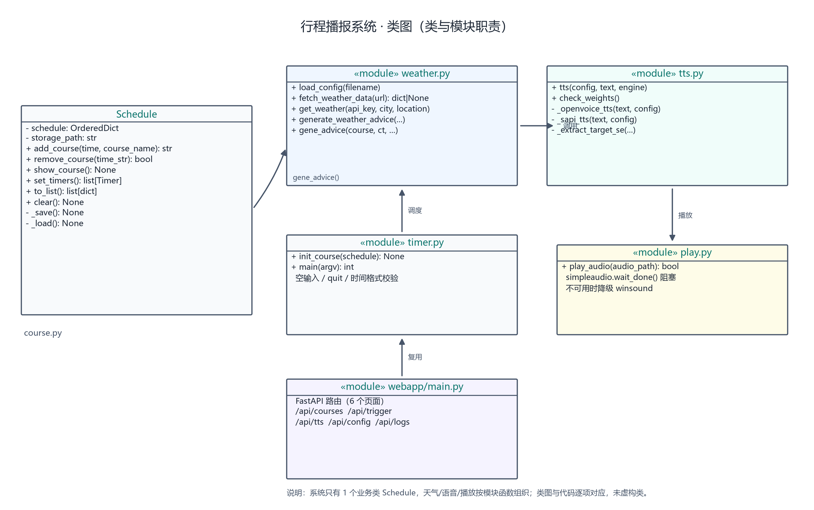
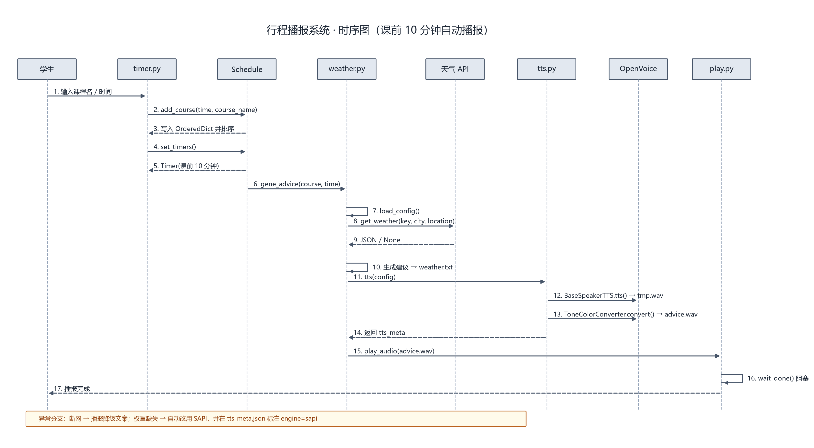

# 软件设计说明书（SDS）

| 项目 | 内容 |
| --- | --- |
| 文档名称 | 基于语音合成技术的行程播报系统 · 概要设计说明书 |
| 版本号 | v1.0 |
| 姓名 | ______ |
| 学号 | ______ |
| 编写日期 | 2026-10-22 |
| 评审关卡 | Rev-B 设计评审 |
| 上游文档 | [SRS v1.0](SRS.md) |

## 目录

1. [设计目标与原则](#1-设计目标与原则)
2. [模块划分与职责](#2-模块划分与职责)
3. [模块间接口](#3-模块间接口)
4. [数据结构](#4-数据结构)
5. [类图](#5-类图)
6. [时序图](#6-时序图)
7. [关键设计决策](#7-关键设计决策)
8. [需求—设计—实现—测试映射](#8-需求设计实现测试映射)
9. [异常处理设计](#9-异常处理设计)
10. [部署与运行设计](#10-部署与运行设计)

---

## 1. 设计目标与原则

| 目标 | 设计手段 |
| --- | --- |
| 主链路一条命令跑通 | `gene_advice()` 作为唯一编排入口，CLI 与 Web 都调用它 |
| 模块可独立验证 | 天气与 TTS 延迟导入，先跑"无模型链路"再跑"模型链路" |
| 设计与代码一致 | 类图只画真实存在的类和函数，不虚构；方法签名逐字对齐 |
| 失败可定位 | 每个降级分支都写 `fallback_reason` 到 `tts_meta.json` 或运行日志 |
| 不做过度设计 | 只有 1 个业务类 `Schedule`，其余按模块函数组织，不强行套设计模式 |

---

## 2. 模块划分与职责

| 模块 | 文件 | 职责 | 对外主要入口 |
| --- | --- | --- | --- |
| 课程表模块 | `course.py` | 课程增删查、按时间排序、持久化、课前定时 | `Schedule` 类 |
| 天气建议模块 | `weather.py` | 读配置、调双接口、生成建议文本、写 `weather.txt`、全链路编排 | `get_weather`、`generate_weather_advice`、`gene_advice` |
| 资讯模块 | `news.py` | 抓取公开 RSS、城市过滤、缓存与播报拼接 | `collect()`、`append_to_advice()` |
| 多语言语音层 | `voices.py` | 语言/音色注册表，edge/Piper/SAPI/OpenVoice/云 TTS 分派 | `catalog()`、`synthesize()` |
| 语音合成模块 | `tts.py` | OpenVoice 两级合成、SAPI 降级、技术指标落盘 | `tts()`、`check_weights()` |
| 播放模块 | `play.py` | 阻塞播放 WAV，库不可用时降级 | `play_audio()` |
| 命令行入口 | `timer.py` | 交互录入、输入校验、设置定时器、端到端演示 | `init_course()`、`run_demo()`、`main()` |
| Web 控制台 | `webapp/main.py` + 模板/静态资源 | 8 个页面与 REST API，双主题 | FastAPI 路由 |
| 工具脚本 | `scripts/` | 权重下载、参考音频生成、UML 图、文档导出 | `download_models.py` 等 |

**分层关系：**

```
timer.py / webapp
      │
      ▼
weather.gene_advice()  ←── 编排层（唯一全链路入口）
      │        │
      ▼        ▼
  weather.py   tts.py ──→ play.py
      │
      ▼
  course.Schedule（被 timer / webapp 调用）
```

---

## 3. 模块间接口

### 3.1 `Schedule`（course.py）

| 方法 | 参数 | 返回值 | 说明 |
| --- | --- | --- | --- |
| `add_course` | `time: datetime.time`, `course_name: str` | `str`（`"09:00"`） | 校验、写入 `OrderedDict`、排序、持久化 |
| `remove_course` | `time_str: str` | `bool` | 删除并持久化 |
| `show_course` | 无 | `None` | 按顺序打印 `09:00 - 高等数学` |
| `set_timers` | 无 | `list[threading.Timer]` | 课前 10 分钟触发 `gene_advice` |
| `to_list` | 无 | `list[dict]` | Web / 测试用的只读视图 |
| `clear` | 无 | `None` | 清空并持久化 |

> **与类图一致性**：类图中的 3 个核心方法名、参数个数、返回值与上表完全一致；`remove_course`、`to_list`、`clear`、`_save`、`_load` 也一并画出，没有多画不存在的类。

### 3.2 天气模块（weather.py）

| 函数 | 参数 | 返回值 | 说明 |
| --- | --- | --- | --- |
| `load_config` | `filename="config.yaml"` | `dict` | 相对路径按项目根解析 |
| `fetch_weather_data` | `url: str` | `dict \| None` | `timeout=10` + `raise_for_status`，异常返回 `None` |
| `get_weather` | `api_key`, `city=None`, `location=None`, `api_host="devapi.qweather.com"` | `dict` | 字典推导组织 `weather_now` / `minutely`；`api_host` 适配新版专属域名 |
| `generate_weather_advice` | `data`, `course`, `course_time`, `output_dir=None` | `str` | 生成文本并写 `weather.txt` |
| `gene_advice` | `course`, `course_time`, `config_path`, `speak=True`, `engine=None`, `news_items=None` | `dict` | 全链路编排，返回运行摘要；`news_items` 非空时拼进建议，为 `None` 时按 `config.news.enabled` 自动抓取 |

`gene_advice` 返回结构：

```json
{
  "course": "高等数学",
  "course_time": "09:00:00",
  "data_source": "mock | qweather | qweather-failed",
  "advice": "当前时间为…",
  "weather": {},
  "engine": "openvoice | sapi",
  "audio": "outputs/advice.wav",
  "tts": {"sample_rate": 22050, "duration": 12.7, "size_kb": 547.0},
  "ok": true
}
```

### 3.3 语音与播放（tts.py / play.py）

| 函数 | 参数 | 返回值 | 说明 |
| --- | --- | --- | --- |
| `check_weights` | `config=None` | `dict` | 检查 5 个权重文件，返回缺失清单 |
| `tts` | `config=None`, `text=None`, `engine=None` | `dict` | 文本 → `tmp.wav` → `advice.wav`，返回技术指标 |
| `play_audio` | `audio_path: str` | `bool` | 阻塞播放，文件缺失抛 `FileNotFoundError` |

`tts()` 返回的 `tts_meta.json` 字段：`engine`、`device`、`tmp_path`、`save_path`、`sample_rate`、`duration`、`size_kb`、`reference_segments`、`reference`、`timestamp`、`fallback_reason`。

### 3.4 资讯模块（news.py）

| 函数 | 参数 | 返回值 | 说明 |
| --- | --- | --- | --- |
| `parse_feed` | `xml_text: str`, `source=""` | `list[dict]` | 纯函数解析 RSS，坏 XML 返回 `[]`（可脱网测试） |
| `fetch_feed` | `url`, `source=""`, `timeout=10` | `list[dict]` | 单源抓取，异常返回 `[]` |
| `filter_items` | `items`, `city_key` | `list[dict]` | 关键词命中排序 + 标题去重 + 截断 |
| `collect` | `city_key=None`, `limit=6`, `force=False` | `dict` | 30 分钟缓存，缓存含 `raw` 全量素材；切城市直接本地重排，全源失败回退过期缓存并置 `stale` |
| `brief` | `items`, `count=2` | `list[str]` | 压缩成可朗读短句，优先本地 |
| `append_to_advice` | `advice`, `items`, `count=2` | `str` | 拼接进建议文本，无资讯时原样返回 |

缓存结构为 `{city, updated, items, raw}`：`items` 是当前城市过滤后的结果，`raw` 是三个 RSS 去重后的全量素材（上限 120 条）。这样换城市只需 `filter_items(raw, city)`，无需重新抓网；缓存过期（30 分钟）后才回源。

### 3.5 多语言语音层（voices.py）

| 函数 | 参数 | 返回值 | 说明 |
| --- | --- | --- | --- |
| `catalog` | 无 | `dict` | 语言 + 音色 + 角色风格 + 引擎能力，供 `/api/voices` 与模板使用 |
| `voice_available` | `voice: dict` | `(bool, reason)` | 按引擎检查 edge 安装 / 模型 / 系统语音 / 权重 / 云配置 |
| `default_voice` | `lang: str` | `str` | 该语言第一个可用音色 ID |
| `get_style` | `style_id` | `dict` | 角色预设，未知 ID 回退 `natural` |
| `_apply_style` | `path`, `style_id` | `dict` | 对 wav 做音高/语速/机械处理，原地覆盖（幅度 ±1~2 半音） |
| `broadcast_text` | `lang`, `course`, `minutes`, `feels`, `weather_text`, `city_name`, `city_key`, `advice`, `weather_data=None`, `now=None` | `str` | 中文用完整建议；其他语言按「时段/时间/倒计时/体感/降水/资讯」逐句拼成与中文等长的文案，降水与体感复用 `weather.describe_conditions()` |
| `describe_conditions`（weather.py） | `data`, `now=None` | `dict` | 把天气 JSON 归一为 `data_ok / clock / feels / weather / temp_level / rain / rain_minutes`，中文建议与外语播报共用同一套判定 |
| `synthesize` | `text`, `lang`, `voice_id=None`, `speed=1.0`, `out_path=None`, `allow_fallback=True`, `style="natural"` | `dict` | 分派 edge / piper / sapi / openvoice / cloud；未指定音色时先按 `STYLE_VOICES` 换真人音色，换不到再叠加 DSP |
| `load_cloud_config` | 无 | `dict` | `config.yaml` 的 `cloud_tts`，`config.local.yaml` 覆盖 |
| `_tc3_signature` | `secret_id`, `secret_key`, `host`, `action`, `payload`, `timestamp` | `str` | 腾讯云 TC3-HMAC-SHA256 签名（CanonicalHeaders 含 content-type/host/x-tc-action） |
| `_tencent_tts` | `text`, `lang`, `voice_id`, `out_path`, `speed` | `dict` | 腾讯云 TextToVoice（2019-08-23），base64 解码后写 wav，缺 `voice_map` 直接报错 |
| `check_cloud` | 无 | `dict` | 用当前云配置试合成一句粤语，成功/失败都返回可读原因（`--check-cloud`） |
| `sapi_voices` | `force=False` | `list[dict]` | 列出 Windows 已安装系统语音（name/culture），本进程缓存 |
| `sapi_voice_for` | `model: str` | `str` | 把音色配置解析成实际语音名：完整名精确匹配，文化标签（`zh-HK`）按前缀匹配，用于粤语语音包 |

`synthesize()` 的产物固定为 `outputs/voice_<id>.wav` + `outputs/voice_meta.json`，与主链路 `advice.wav` 隔离，保证评分证据不被试听覆盖。
默认音色为 edge 神经网络音色（`edge_tts.Communicate` → 临时 MP3 → 解码写 WAV），音质明显好于 Piper 轻量模型；断网或未安装时按注册表顺序回退。
云 TTS 有两条分支：`provider: tencent` 走 TC3 签名 + `TextToVoice`；其他厂商沿用通用 HTTP 契约（POST JSON，响应体为音频字节）。未配置或调用失败时降级 `piper` 并在 `fallback_reason` 写明原因。
粤语三档回退：edge `zh-HK-HiuMaanNeural` → 本机 SAPI `zh-HK` → 腾讯云；都没有时 `voice_available` 明确提示，不冒充方言。

---

## 4. 数据结构

### 4.1 课程表：嵌套字典（时间 → 课程信息）

```python
OrderedDict([
    ("09:00", {"course_name": "高等数学", "time": datetime(2026, 10, 22, 9, 0)}),
    ("14:00", {"course_name": "大学物理", "time": datetime(2026, 10, 22, 14, 0)}),
])
```

- 外层键：`HH:MM` 字符串，天然可比较、可直接用于 Web 路由参数；
- 内层值：课程名 + 当天 `datetime`，`set_timers` 直接用它计算 `timedelta`；
- `OrderedDict` + `sorted(items())` 保证遍历顺序就是上课顺序。

持久化文件 `data/courses.json`：

```json
[
  {"time": "09:00", "course_name": "高等数学"},
  {"time": "14:00", "course_name": "大学物理"}
]
```

### 4.2 天气数据：双接口字典

```python
{
  "weather_now": {
    "code": "200",
    "now": {"temp": "24", "feelsLike": "26", "text": "多云", ...}
  },
  "minutely": {
    "summary": "未来两小时无降水",
    "minutely": [{"fxTime": "2026-10-22T09:00+08:00", "precip": "0.0", "type": "rain"}]
  }
}
```

- `weather_now is None` → 没网 / 接口失败；
- `minutely` 缺失 → 只跳过降水判断，不影响体感建议；
- `now` 缺 `feelsLike` → 视为字段缺失，走降级文案。

### 4.3 配置：`config.yaml`

关键字段：`provider`（mock/qweather）、`api_key`（占位符）、`api_host`（和风控制台分配的 API Host）、`default_city`、`cities`（city + location）、`reminder_minutes`、5 个权重路径、`tts_engine`、`speed`、`paths`。

### 4.4 运行日志：`data/runs.jsonl`

每次 `gene_advice` 追加一行：时间、课程、课程时间、数据源、引擎、音频路径、建议文本。Web 日志页倒序读取最近 50 条。

---

## 5. 类图



**图 5-1 说明**

- 业务类只有 `Schedule` 一个，字段 `schedule: OrderedDict`、`storage_path: str`；
- 公共方法 6 个、私有方法 2 个，与 `course.py` 一一对应；
- `weather.py`、`tts.py`、`play.py`、`timer.py`、`webapp/main.py` 是模块而非类，图中用 `«module»` 标注，避免"画了 5 个类、代码只有 1 个类"的不一致；
- 依赖关系：`Schedule` 定时调用 `weather.gene_advice()`；`weather` 调 `tts()`；`tts` 调 `play.py`；`timer` / `webapp` 复用 `Schedule`。

---

## 6. 时序图



**图 6-1 主路径（课前 10 分钟自动播报）**

1. 学生输入课程名与时间；
2. `timer.py` 调 `Schedule.add_course(time, course_name)`；
3. `Schedule` 写入 `OrderedDict` 并按时间排序后返回；
4. `timer.py` 调 `Schedule.set_timers()`；
5. `Schedule` 计算 `course_time - timedelta(minutes=10)`，创建 `threading.Timer`；
6. 到点后 Timer 调用 `weather.gene_advice(course, time)`；
7. `weather` 读配置，调 `get_weather(key, city, location)`；
8. 天气 API 返回 JSON 或 `None`；
9. `weather` 生成建议并写 `weather.txt`；
10. `weather` 调 `tts(config)`；
11. `tts` 调 `BaseSpeakerTTS.tts()` 产出 `tmp.wav`；
12. `tts` 调 `ToneColorConverter.convert()` 产出 `advice.wav`；
13. `tts` 返回 `tts_meta`；
14. `weather` 调 `play_audio(advice.wav)`；
15. `play.py` 用 `wait_done()` 阻塞等待播放完成；
16. 播报完成后控制权回到学生侧。

异常分支（图底部）：断网 → 播报降级文案；权重缺失 → 自动改用 SAPI 并在 `tts_meta.json` 标注 `engine=sapi`。

---

## 7. 关键设计决策

| 编号 | 决策 | 理由（本人判断） |
| --- | --- | --- |
| DD-01 | `add_course` 用 `OrderedDict`，每次写入后 `sorted()` 重建 | 普通 `dict` 在 3.7+ 虽保插入序，但插入序不等于时间序；`OrderedDict` 明确表达"有序课程表"的语义，排序逻辑集中在 `add_course`，`show_course` / `set_timers` 不再各自排序。 |
| DD-02 | 提前量用 `timedelta(minutes=10)` 硬编码，不读 `reminder_minutes` | 评分细则要求"课前 10 分钟"，配置项保留作扩展说明；硬编码保证评审时行为可预期，避免配置文件被改后与文档不符。 |
| DD-03 | `tts.py` 保留 `tmp.wav` 中间产物 | 两级流程可分别验证：`tmp.wav` 证明基础合成成功，`advice.wav` 证明音色转换成功；若只保留最终文件，失败时无法判断是哪一级出错。 |
| DD-04 | 参考音频等长切 3 段后平均音色 | OpenVoice 官方 `se_extractor` 依赖 whisper VAD，本机无法联网下载模型；等长切段输入明确、可复现，3 段能覆盖不同音节又不至于让 `extract_se` 过慢。 |
| DD-05 | 时间解析用 `datetime.fromisoformat()` | 接口 `fxTime` 带 `+08:00` 时区，`strptime("%Y-%m-%dT%H:%M:%S")` 会直接报错；`fromisoformat` 同时兼容带/不带时区两种格式。 |
| DD-06 | 天气默认 `provider: mock`，真实 Key 才走外网 | 演示环境可能断网；mock 字段与真实返回一致，保证链路可跑。真实 Key 通过配置切换，不写进代码。 |
| DD-07 | OpenVoice 失败降级 SAPI，且显式记录原因 | 降级是为了"演示不中断"，不是为了"假装成功"；`engine` 与 `fallback_reason` 让评审能区分模型输出与系统朗读。 |
| DD-08 | 模型对象缓存在 `_MODEL_CACHE` | 292MB 权重每次播报都重新加载会让单次耗时增加数十秒；缓存后同一进程内只加载一次。 |
| DD-09 | 公共函数返回结构化 `dict`，不打印后让调用方解析字符串 | CLI、Web、pytest 三种调用方都需要结果；返回 `dict` 避免解析终端输出。 |
| DD-10 | Web 控制台复用同一套模块函数，不另写业务逻辑 | 防止"CLI 能跑、Web 跑的是另一套逻辑"；Web 只做参数校验与展示。 |
| DD-11 | 角色音色优先换真人神经音色，换不到才做 DSP 叠加 | 本机只有 5 个 Piper 模型 + 2 个系统语音，无法覆盖"萝莉/大叔/播音腔"；先用 `STYLE_VOICES` 把角色映射到最贴近的 edge 音色（萝莉→晓伊、大叔/播音男→云健/云扬、播音女→晓晓），音质无损；edge 不可用时才用 `librosa` 做 ±1~2 半音 + 语速调整（上一版 ±6 半音会产生明显相位伪影，已下调）。新增角色只改 `STYLES` / `STYLE_VOICES`。 |
| DD-12 | 网页一键播报默认 `fast`（edge/Piper/SAPI），`clone` 保留 OpenVoice | CPU 上 OpenVoice 单次十几秒，日常点击"立即播报"体验差；`fast` 约 5 秒出声，且写入独立文件 `voice_broadcast.wav`，不覆盖评分要求的 `advice.wav`。两级流程仍可通过 `clone` 或 `timer.py --demo` 演示。 |
| DD-13 | 非中文播报用模板拼句，不接翻译接口 | 没有离线翻译服务；模板只填课程/分钟/体感/天气四个变量，保证"换语言"后听到的确实是该语言，而不是中文被外语音色硬读。中文仍播完整建议（含资讯与降水）。 |
| DD-14 | 云 TTS 首选项腾讯云，签名自己实现，不引 SDK | 只为一个接口引入腾讯云 SDK 会增加依赖与体积；按官方 TC3-HMAC-SHA256 文档用 `hashlib/hmac` 约 20 行实现，出错时 `voices.py --check-cloud` 直接打印错误码，便于定位。 |
| DD-15 | 城市状态放 `localStorage` + 导航链接带 `?city=`，不在服务端存会话 | 系统是本地单用户、无登录，服务端会话没有意义；URL 参数让服务端渲染直接正确（刷新/分享都不丢城市），`localStorage` 负责跨页面记忆，`BroadcastChannel` + `storage` 事件负责跨标签页跟随。切换城市时浏览器整页跟随而不是每个页面自己拼数据，避免各页面字段口径不一致。 |

---

## 8. 需求—设计—实现—测试映射

| 需求 | 设计（类/接口） | 实现（文件/函数） | 测试用例 |
| --- | --- | --- | --- |
| FR-01 添加课程 | `Schedule.add_course` | `course.py:32-58` | TC-01、TC-02、TC-26 |
| FR-02 展示课程表 | `Schedule.show_course` | `course.py:68-71` | TC-01 |
| FR-03 删除课程 | `Schedule.remove_course` | `course.py:60-66` | TC-25 |
| FR-04 课前 10 分钟触发 | `Schedule.set_timers` + `threading.Timer` | `course.py:91-124` | TC-03、TC-04 |
| FR-05 调用天气接口 | `get_weather` / `fetch_weather_data` | `weather.py:64-99` | TC-11 ~ TC-15 |
| FR-06 生成出行建议 | `generate_weather_advice` / `format_temperature` | `weather.py:115-222` | TC-05 ~ TC-10、TC-16 ~ TC-18 |
| FR-07 两级语音合成 | `tts` / `_openvoice_tts` / `_extract_target_se` | `tts.py:108-160、221-258` | TC-19 ~ TC-23 |
| FR-08 本地播放 | `play_audio` | `play.py:17-37` | TC-24 |
| FR-09 全链路串联 | `gene_advice` | `weather.py:237-306` | TC-27、TC-28 |
| FR-10 Web 控制台 | FastAPI 路由 | `webapp/main.py:199-427` | TC-33 ~ TC-39 |
| FR-11 命令行输入校验 | `init_course` | `timer.py:18-50` | TC-29 ~ TC-32 |
| FR-12 本地实时资讯 | `collect` / `append_to_advice` / `_auto_news` | `news.py`、`webapp/main.py` `/api/news`、`weather.py` | TC-43 ~ TC-50、TC-62、TC-63、TC-67 |
| FR-13 多语言多音色 | `synthesize` / `catalog` | `voices.py`、`/api/voices`、`/api/voice/tts` | TC-51 ~ TC-61、TC-64 ~ TC-66 |
| FR-14 双主题界面 | CSS 变量 + `data-theme` | `webapp/static/theme.css`、`base.html`、`news.html` | TC-33、TC-62 |
| FR-15 播报控制台 | `TriggerIn` + `STYLES` + `broadcast_text` | `webapp/main.py` `api_trigger`、`voices.py`、`dashboard.html`、`app.js` | TC-68 ~ TC-71 |

---

## 9. 异常处理设计

| 层级 | 异常 | 处理策略 | 证据 |
| --- | --- | --- | --- |
| 输入层 | 空课程名、非法时间、过去时间 | 拒绝写入并提示，循环等待下一次输入 | `timer.py` 提示文本、Web 400/422 |
| 网络层 | 断网、超时、非 2xx | `fetch_weather_data` 捕获 `RequestException` 返回 `None` | `weather.py:64-73` |
| 数据层 | 字段缺失、类型错误 | 判定 `feelsLike` 缺失走降级；非数字按 20℃；时间解析失败按 0 分钟 | `weather.py:164-216` |
| 模型层 | 权重缺失、参考音频缺失、推理异常 | `auto` 模式降级 SAPI 并记录原因；`openvoice` 模式显式抛错 | `tts.py:249-258` |
| 播放层 | 文件缺失、解码失败 | 原样抛出，不吞异常 | `play.py:25-37` |
| 持久化层 | JSON 损坏 | 捕获后清空课程表并告警，不阻塞启动 | `course.py:153-156` |
| Web 层 | 参数非法、课程不存在、TTS 失败 | 400 / 404 / 422 / 500，错误信息带中文原因 | `webapp/main.py` |

---

## 10. 部署与运行设计

- 入口 1：`python timer.py`（交互录入）与 `python timer.py --demo`（端到端演示）。
- 入口 2：`python weather.py --advice-only`（无模型链路，只产 `weather.txt`）。
- 入口 3：`python tts.py --text "..."`（单独测试合成）。
- 入口 4：`python -m uvicorn webapp.main:app --port 8000`（Web 控制台）。
- 测试入口：`python -m pytest -q`。
- 权重准备：`python scripts/download_models.py`（hf-mirror，5 个文件）。
- 参考音频准备：`python scripts/make_reference.py`（SAPI Huihui 生成 30 秒 WAV）。
- 配置：复制 `config.yaml`，把 `api_key` 换成真实值、`provider` 改为 `qweather`、`api_host` 改为控制台分配的域名（新版账号形如 `xxxx.qweatherapi.com`）；不配置则默认 mock。
