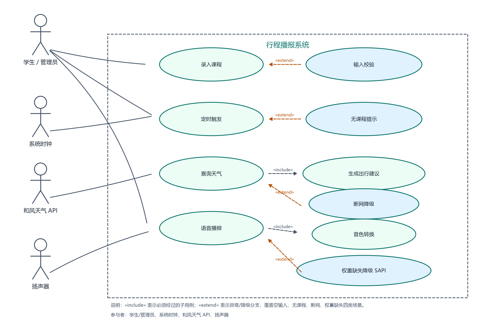

# 软件需求规格说明书（SRS）

| 项目 | 内容 |
| --- | --- |
| 文档名称 | 基于语音合成技术的行程播报系统 · 软件需求规格说明书 |
| 版本号 | **v1.0** |
| 课程 | 《人工智能程序设计》第 4 章 |
| 姓名 | ______ |
| 学号 | ______ |
| 编写日期 | 2026-10-22 |
| 评审关卡 | Rev-A 需求评审 |

## 目录

1. [项目背景与目标](#1-项目背景与目标)
2. [总体描述（含 2.4 技术选型论证）](#2-总体描述)
3. [术语表](#3-术语表)
4. [功能需求](#4-功能需求)
5. [性能需求](#5-性能需求)
6. [设计约束](#6-设计约束)
7. [用例图](#7-用例图)
8. [需求追溯矩阵](#8-需求追溯矩阵)
9. [验收标准](#9-验收标准)

---

## 1. 项目背景与目标

### 1.1 项目背景

学生每天按课程表在多栋教学楼之间移动，出门前需要同时判断三件事：现在几点、下一节课几点、外面天气如何。现有做法是人工看时钟、翻课程表、再打开天气 App，属于三次独立操作，课前容易遗漏。

本章要求把这三步合并成一条自动链路：课程信息进入系统后，系统在**课前 10 分钟**自动查询天气、生成一句完整的出行建议，并用**指定音色**的语音播报出来。

### 1.2 项目目标

| 编号 | 目标 | 判定方式 |
| --- | --- | --- |
| G-1 | 一条命令完成"配置 → 天气 → 建议 → 文本 → 合成 → 播放"，中间无手工拷贝 | `python timer.py --demo` 一次跑通并出声 |
| G-2 | 语音必须体现"基础合成 + 音色转换"两级流程，而不是直接调用系统朗读 | `outputs/tmp.wav` 与 `outputs/advice.wav` 同时存在，`tts_meta.json` 记录 `engine` |
| G-3 | 核心模块可独立测试，边界与异常有断言覆盖 | `pytest -q` 全绿，改坏阈值能变红 |
| G-4 | 提供可视化控制台作为拓展，降低演示与日常使用门槛 | FastAPI 七个页面可访问 |

### 1.3 项目范围

**范围内：**

- 课程录入、排序、持久化、删除；
- 课前 10 分钟定时触发与"已进入提醒窗口立即触发"；
- 和风天气实时天气 + 分钟级降水两个接口的调用、解析与降级；
- 出行建议文本生成（含体感温度三分支、雨雪判断、降水提醒）；
- OpenVoice 两级语音合成与本地播放；
- Web 控制台（仪表盘、可视化大屏、课程管理、天气预览、语音工坊、设置、运行日志）。

**范围外（明确不做，避免过度设计）：**

- 多用户账号、权限、云端数据库；
- 移动端 App 与安卓客户端；
- 语音识别（本系统只做"文本 → 语音"单向链路）；
- 实时 GPS 定位与路线规划；
- 商业化天气套餐、地图 SDK 集成。

> **为什么这样划范围**：评分细则的 4 个主用例全部落在"课程 + 天气 + 播报"上，账号体系、移动端、定位都属于另一个产品形态。把范围收窄可以保证每个功能都能被测试和演示覆盖，而不是堆功能导致主链路不稳。

---

## 2. 总体描述

### 2.1 产品定位

一个**单机、离线优先**的桌面行程播报工具：学生在命令行录入课程，系统在课前 10 分钟自动用指定音色播报"当前时间 + 课程倒计时 + 体感温度建议 + 降水提醒"。另附 Web 控制台用于可视化操作与演示。

### 2.2 用户角色与运行环境

| 角色 | 职责 | 使用方式 |
| --- | --- | --- |
| 学生（主用户） | 录入/删除课程、查看课程表、试听播报 | CLI 或 Web 控制台 |
| 和风天气接口（外部系统） | 提供实时天气与分钟级降水 JSON | HTTPS GET，需 API Key |
| 扬声器（外部设备） | 播放合成后的 WAV | `simpleaudio` 或 `winsound` |

运行环境：

- Python **3.11**（本机 `D:\python311\python.exe`，项目虚拟环境 `.venv`）；
- Windows 10/11（播放与 SAPI 保底依赖 Windows 组件）；
- 内存 ≥ 8GB，磁盘 ≥ 1GB（OpenVoice 权重约 292MB）；
- 可选 NVIDIA GPU（有则用 `cuda:0`，无则 CPU 推理）。

### 2.3 假设与依赖

- 假设用户能提供合法天气 API Key；无 Key 时系统使用内置离线样例（`provider: mock`），保证断网也能演示。
- 依赖 OpenVoice V1 五个权重文件；缺失时允许降级 Windows SAPI，但必须在 `tts_meta.json` 与界面标注 `engine=sapi`。
- 依赖参考音频 `resources/ly2.wav`（约 30 秒中文语音）作为目标音色来源。
- 课程时间按"今天"解释；跨天课程不在本期范围。

### 2.4 技术选型论证

**结论：选择 OpenVoice V1，采用"基础语音合成 + 音色转换"两级流程；不使用 pyttsx3 / Windows SAPI / 通用云 TTS 作为主引擎。**

**（1）OpenVoice 的两级是什么**

| 级别 | 组件 | 输入 | 输出 | 作用 |
| --- | --- | --- | --- | --- |
| 第一级 | `BaseSpeakerTTS.tts()` | 待播报文本 | `outputs/tmp.wav` | 用内置说话人的**平均音色**把文字读成语音，解决"会不会读" |
| 第二级 | `ToneColorConverter.convert()` | `tmp.wav` + 源音色向量 + 目标音色向量 | `outputs/advice.wav` | 把平均音色**转换**为参考音频的音色，解决"像不像" |

目标音色向量由参考音频切 3 段后逐段 `extract_se()` 再取平均得到；源音色向量使用官方 `zh_default_se.pth`。

**（2）为什么不用通用 TTS**

通用 TTS（pyttsx3、SAPI、多数云厂商的默认发音人）本质是"从预置发音人里挑一个"，只能改语速、音量、音调，**不能把声音变成指定的某个人**。本系统的需求是"用指定音色播报"（例如用班主任或课程录制者的声音），这是音色克隆问题，不是朗读问题。通用 TTS 无法满足，直接排除主引擎地位。

**（3）为什么不用云 TTS 的音色克隆**

云厂商的音色克隆需要上传声纹、联网、实名与计费，演示环境断网即失效，且评分细则明确要求"音频必须本机生成"。OpenVoice 本地推理、MIT 许可、可离线，符合约束。

**（4）为什么保留 SAPI**

CPU 推理一次完整建议约十秒级，权重缺失或环境异常时如果直接崩溃，演示无法继续。SAPI 作为**显式降级**而不是替代：只在 OpenVoice 不可用时启用，并在元数据里写清 `engine=sapi` 与 `fallback_reason`，不冒充模型输出。

**（5）取舍代价（本人判断）**

- 代价一：需要 292MB 权重与额外依赖（torch、librosa），首次安装慢；
- 代价二：CPU 推理比云 TTS 慢，因此模型只加载一次并缓存（`_MODEL_CACHE`），播报文本控制在两句以内；
- 收益：离线可用、音色可控、两级流程可分别验证（先跑无模型链路，再跑模型链路），出错时能定位到"文本/权重/推理"哪一层。

---

## 3. 术语表

| 术语 | 本系统中的解释（非照抄） |
| --- | --- |
| TTS（Text To Speech） | 把文字转成可播放音频的过程。本系统最终产物是 `outputs/advice.wav`，不是屏幕上的文字。 |
| 音色（Tone Color） | 决定"听起来是谁在说"的声学特征，与说了什么内容无关。本系统用 `resources/ly2.wav` 的音色作为目标。 |
| 风格参数（Style Parameters） | 控制语速、停顿、语调等的可调项。本系统通过 `speed`、`noise_scale`、`length_scale` 影响节奏，但不改变音色。 |
| 可逆归一化流（Reversible Normalizing Flow） | 一种可正反双向计算的概率变换网络。`ToneColorConverter` 用它把语音内容与音色解耦，因此能在不改文字的情况下替换音色。 |
| 零样本（Zero-shot） | 不重新训练模型，只用一小段参考音频就能克隆音色。本系统没有训练任何模型，只对 `ly2.wav` 提取音色向量。 |
| 源音色 / 目标音色（Source/Target SE） | 源音色是基础说话人的平均音色（`zh_default_se.pth`）；目标音色是从参考音频提取的向量。转换就是把前者替换为后者。 |
| 体感温度（Feels Like） | 接口返回的"人实际感受到的温度"，与气温不同。本系统按 `<8`、`8~28`、`>28` 三档给出穿衣建议。 |
| 分钟级降水（Minutely Precipitation） | 未来两小时每 5 分钟一格的降水预报。本系统用它判断"要不要带伞"。 |

---

## 4. 功能需求

功能需求统一编号 `FR-xx`，每条按**输入 → 处理 → 输出**描述，并单列异常处理。

### 4.1 用例总览

| 用例编号 | 用例名称 | 参与者 | 对应需求 |
| --- | --- | --- | --- |
| UC-01 | 录入课程 | 学生 | FR-01、FR-02、FR-03 |
| UC-02 | 定时触发 | 学生、系统时钟 | FR-04 |
| UC-03 | 查询天气 | 学生、和风天气接口 | FR-05、FR-06 |
| UC-04 | 语音播报 | 学生、扬声器 | FR-07、FR-08、FR-09 |
| UC-05 | 查看本地资讯 | 学生、公开 RSS 源 | FR-12 |
| UC-06 | 多语言试听 | 学生 | FR-13 |
| UC-07 | 切换界面主题 | 学生 | FR-14 |
| UC-08 | 切换地区/语言/音色角色并播报 | 学生、扬声器 | FR-15 |

### 4.2 UC-01 录入课程

**FR-01 添加课程**

- 输入：课程名称（非空字符串）+ 上课时间（`HH:MM`，24 小时制）。
- 处理：去除首尾空格 → 校验非空 → `datetime.strptime("%H:%M")` 校验格式 → 组合为今天的 `datetime` → 以 `HH:MM` 为键写入 `OrderedDict` → 按时间升序重排 → 持久化到 `data/courses.json`。
- 输出：返回格式化时间字符串（如 `09:00`），课程表按时间升序保存。
- 异常处理：
  - 课程名为空 → 抛 `ValueError("课程名不能为空")`，不写入；
  - 时间不是 `datetime.time` → 抛 `TypeError`；
  - 同一时间重复录入 → 覆盖该时段课程（键唯一），不产生重复行；
  - 存储文件损坏 → 启动时捕获 `JSONDecodeError/KeyError/ValueError`，清空并告警，不阻塞启动。

**FR-02 展示课程表**

- 输入：无。
- 处理：按 `OrderedDict` 顺序遍历。
- 输出：逐行打印 `09:00 - 高等数学`（固定格式：时间 + 空格 + 连字符 + 空格 + 课程名）。
- 异常处理：课程表为空 → 不打印任何课程，由调用方（`timer.py`）提示"课程表为空，未设置任何定时器"。

**FR-03 删除课程**

- 输入：时间字符串 `HH:MM`。
- 处理：在 `OrderedDict` 中查找并删除，随后持久化。
- 输出：删除成功返回 `True`，不存在返回 `False`。
- 异常处理：时间键不存在 → 返回 `False`，Web 层映射为 HTTP 404，不抛未捕获异常。

**FR-11 命令行输入校验**

- 输入：标准输入的课程名与 `HH:MM` 时间。
- 处理：读取 → `strip()` → 判断 `quit` → 校验非空 → `strptime("%H:%M")` → 与当前时间比较。
- 输出：合法则写入课程表；输入 `quit` 结束录入并打印课程表。
- 异常处理：
  - `quit`（不区分大小写）→ 立即退出录入循环；
  - 空课程名 → 提示后重新输入，不写入；
  - 格式错误（如 `9:00`、`25:00`）→ 捕获 `ValueError`，提示后重新输入；
  - 时间早于当前时间 → 提示"必须晚于当前时间"，重新输入。

### 4.3 UC-02 定时触发

**FR-04 课前 10 分钟定时触发**

- 输入：课程表中的每一条课程（时间 + 名称）、当前系统时间。
- 处理：`reminder_time = course_time - timedelta(minutes=10)`；计算与当前时间的秒差：
  - 差值 > 0 → 创建 `threading.Timer(delay, gene_advice, args=(课程名, 课程时间))`，设为守护线程并启动；
  - 差值 ≤ 0（已进入课前 10 分钟或已过点）→ 立即调用 `gene_advice`。
- 输出：返回已启动的 `Timer` 列表；命令行进程阻塞等待，`Ctrl+C` 时取消全部定时器。
- 异常处理：
  - 无课程 → 返回空列表，不创建线程；
  - 课程时间已过 → 走"立即播报"分支，不设置负延迟定时器（`threading.Timer` 不接受负值语义）；
  - 主进程退出 → 守护线程随进程结束，不悬挂。

### 4.4 UC-03 查询天气

**FR-05 调用天气接口**

- 输入：API Key、城市代码 `city`（实时天气）、经纬度 `location`（分钟级降水）。
- 处理：用字典推导同时组织两个接口：
  - `weather_now` → `https://devapi.qweather.com/v7/weather/now?location={city}&key={api_key}`
  - `minutely` → `https://devapi.qweather.com/v7/minutely/5m?location={location}&key={api_key}`
  - 每个请求 `timeout=10`，并调用 `raise_for_status()`。
- 输出：`{"weather_now": dict|None, "minutely": dict|None}`。
- 异常处理：
  - 断网 / 超时 / 非 2xx → `fetch_weather_data` 捕获 `RequestException` 返回 `None`，**不抛出**；
  - 只给 `city` 不给 `location` → 跳过分钟级接口，字典中不出现 `minutely` 键；
  - `city` 与 `location` 都为空 → 抛 `ValueError("必须提供城市代码参数！")`；
  - 使用占位 Key 或 `provider: mock` → 不请求外网，直接返回内置离线样例。

**FR-06 生成出行建议文本**

- 输入：天气 JSON（或 `None`）、课程名称、课程时间。
- 处理：
  1. 计算当前时间与课程时间的分钟差，生成"当前时间为 X 点 Y 分，N 分钟之后有《课程》课。"；距离超过 60 分钟时写成"X小时Y分钟"，当天课程已过点则按次日同一时刻计算，避免出现"0分钟之后"；
  2. 读取 `feelsLike`，按 `<8` 保暖、`8~28` 适宜、`>28` 防暑三分支生成体感建议；
  3. 当前天气文本含 `'雨'` → 带伞；含 `'雪'` → 带伞并加衣；
  4. 当前无雨雪时遍历分钟级降水，`precip > 0` 且 `type in ("rain","snow")` → 生成"N 分钟后可能下 X"；
  5. 未来两小时无降水 → "未来两小时没有降水，可以不用带伞。"；
  6. 写入 `resources/weather.txt`（UTF-8，无 BOM）。
- 输出：完整建议字符串 + `weather.txt` 文件。
- 说明：`gene_advice` 在资讯之后追加一条"每日告别语"（如"最后祝你有开心的一天，事事顺利，感谢收听。"），按日期从 8 条中文候选里固定取一条，同一天重复播报不跳、跨天自动换；外语播报各有 3 条对应语言的告别语。告别语计入 `weather.txt` 与最终音频，整段播报约 27~30 秒。
- 异常处理：
  - 天气数据为 `None`（断网/接口失败）→ 输出"当前无法获取天气数据，请检查网络后重试……"，不抛异常，保证播报链路不中断；
  - `now` 或 `feelsLike` 字段缺失 → 输出"天气数据不完整……"，保留课程提醒；
  - `feelsLike` 不是数字 → 按 20℃ 兜底；
  - 分钟级降水时间带 `+08:00` → 用 `datetime.fromisoformat()` 解析，失败则按 0 分钟处理；
  - 空课程表 → 由 Web 层以"自习"占位，CLI 层不触发播报。

### 4.5 UC-04 语音播报

**FR-07 两级语音合成**

- 输入：建议文本、`config.yaml`（权重路径、参考音频、引擎、语速）。
- 处理：
  1. 若文本为空 → 读 `resources/weather.txt`；仍为空则报错；
  2. 第一级：`BaseSpeakerTTS.tts(text, tmp.wav, speaker="default", language="Chinese")`；
  3. 第二级：`ToneColorConverter.convert(tmp.wav, src_se, tgt_se, advice.wav)`；
  4. `device = "cuda:0" if torch.cuda.is_available() else "cpu"`；模型只加载一次并缓存；
  5. 目标音色：参考音频等长切 3 段 → 逐段 `extract_se()` → 平均。
- 输出：`outputs/tmp.wav`（中间产物）、`outputs/advice.wav`（最终音频，22050Hz）、`outputs/tts_meta.json`（引擎、设备、采样率、时长、大小、切段数、降级原因）。
- 异常处理：
  - 权重缺失（5 个文件任一不存在）→ `engine=auto` 时降级 SAPI 并记录 `fallback_reason`；`engine=openvoice` 时显式抛出 `FileNotFoundError`；
  - 参考音频缺失 → 同上；
  - 文本为空 / `weather.txt` 不存在 → 抛 `ValueError` / `FileNotFoundError`，不生成静音文件；
  - 不支持的引擎名 → 抛 `ValueError`。

**FR-08 本地播放**

- 输入：WAV 文件路径。
- 处理：优先 `simpleaudio.WaveObject.from_wave_file(...).play().wait_done()`；库不可用时降级 `winsound.PlaySound(..., SND_FILENAME)`（同步阻塞）。
- 输出：播放完成返回 `True`。
- 异常处理：文件不存在 → 抛 `FileNotFoundError`；解码失败 → 原样抛出，不吞异常（评分细则 C-7）。

**FR-09 全链路串联**

- 输入：课程名称、课程时间、`config.yaml`。
- 处理：读配置 → 选数据源（mock/qweather）→ 查询天气 → 生成建议 → 写 `weather.txt` → 合成语音 → 播放 → 追加 `data/runs.jsonl` 运行日志。
- 输出：运行摘要字典（数据源、建议文本、引擎、音频路径、是否成功）。
- 异常处理：
  - qweather 请求失败 → `data_source=qweather-failed`，建议文本降级，仍完成播报；
  - `speak=False` → 只跑无模型链路（Rev-C C-1 演示）；
  - TTS 失败 → 异常向上抛出，Web 层返回 500 并写明"播报失败"。

**FR-10 Web 控制台（拓展需求）**

- 输入：浏览器请求 / JSON 请求体。
- 处理：FastAPI 路由调用上述模块。
- 输出：8 个页面（仪表盘 `/`、可视化大屏 `/stage`、课程 `/courses`、天气 `/weather`、今日资讯 `/news`、语音工坊 `/studio`、设置 `/settings`、日志 `/logs`）+ REST API + `/docs` 自动接口文档。
- 异常处理：课程名/时间非法 → 400；课程不存在 → 404；TTS 参数非法 → 422；TTS 运行失败 → 500；`provider`/`tts_engine` 非法 → 400；日志文件损坏行 → 跳过该行。

**FR-12 本地实时资讯（拓展需求）**

- 输入：城市键（`dalian` / `shuangliu`，默认取 `config.default_city`）；公开 RSS 源。
- 处理：并发抓取中国新闻网滚动 / 社会、人民网时政 3 个 RSS → `ElementTree` 解析 `item` → 按城市关键词（如「大连、辽宁、金普」）命中排序 → 标题去重 → 写入 `data/news_cache.json`（30 分钟 TTL）。
- 输出：本地相关资讯在前、综合资讯补位；播报时取前 1~2 条标题拼进建议（`news.append_to_advice()`）。
- 接入方式：Web（`/api/trigger`、页面预览）显式传 `news_items`；`timer.py` 定时播报不传参时，`gene_advice()` 按 `config.news.enabled` 自动抓取，抓取失败则不带资讯继续播报，不阻断主链路。
- 异常处理：
  - 单个源超时/非 2xx → 返回空列表，不影响其他源；
  - 全部源失败 → 返回过期缓存并置 `stale=true`，页面标注「离线缓存」；
  - XML 结构损坏 → `ParseError` 捕获后返回空列表；
  - 缓存文件损坏 → 当作无缓存，重新抓取，不阻塞请求。

**FR-13 多语言与多音色（拓展需求）**

- 输入：待合成文本 + 语言代码（`zh-CN` / `en-US` / `es-ES` / `yue`）+ 音色 ID（缺省取该语言第一个可用音色）+ 语速。
- 处理：查语言/音色注册表 → 按引擎分派（`edge` 微软神经网络音色 / `piper` 离线模型 / `sapi` 系统语音 / `openvoice` 音色克隆 / `cloud` 云 TTS）→ 结果写入 `outputs/voice_<id>.wav` 与 `outputs/voice_meta.json`。
- 默认音色：每种语言的第一个可用音色，当前为 edge 神经网络音色（普通话晓晓、英语 Aria、西语 Elvira、粤语曉曼），零 Key、需联网；断网或未安装 `edge-tts` 时按注册表顺序回退 Piper。
- 粤语接入：三档，按可用性自动选择 —— ① edge 的 `zh-HK-HiuMaanNeural`（真粤语、零 Key）；② 本机 SAPI `zh-HK` 语音包；③ 腾讯云 TTS（`provider: tencent`，TC3-HMAC-SHA256 签名，`voices.py --check-cloud` 自检）。都不可用时如实提示并降级。
- 音色克隆：`openvoice` 引擎仍然只有普通话与英语两种基础说话人，沿用 PR-01 的两级流程。
- 输出：音频文件 + 指标（引擎、采样率、时长、大小、降级原因）；Web 返回可播放 URL。
- 异常处理：
  - 语言或音色不存在 → `ValueError`，Web 映射 400；
  - 音色与语言不匹配 → `ValueError`，Web 映射 400；
  - Piper 模型缺失 → 标注「模型未下载」，运行 `scripts/download_voices.py`；
  - 系统语音包未安装 → 标注「系统未安装语音「zh-HK」」并降级，`voices.py --sapi` 可查看已装语音；
  - 粤语云 TTS 未配置或调用失败 → 自动降级为普通话音色朗读，并在 `fallback_reason` 写明原因，不冒充方言合成；
  - 关闭降级（`allow_fallback=False`）时 → 直接抛 `RuntimeError`，便于测试断言。

**FR-14 双主题 Web 界面（拓展需求）**

- 输入：浏览器访问；顶栏主题切换按钮。
- 处理：`<html data-theme>` + CSS 变量切换两套配色；选择写入 `localStorage`，首屏内联脚本先应用主题，避免闪烁。
- 输出：8 个页面（新增 `/news` 今日资讯）+ 资讯卡、音色实验室、主题切换；`/api/news`、`/api/voices`、`/api/voice/tts` 三个新接口。
- 异常处理：`localStorage` 不可用 → 退回默认 `candy`；接口异常 → 页面 Toast 提示，不白屏。

**FR-15 播报控制台：地区 / 语言 / 音色角色 / 快速播报（拓展需求）**

- 输入：城市键（`config.yaml` 的 `cities`，内置 15 个城市）+ 语言代码 + 角色风格 ID（`natural` / `anchor_f` / `anchor_m` / `loli` / `uncle` / `robot`）+ 播报模式（`fast` / `clone`）。
- 处理：
  1. `/api/trigger` 读取三个下拉参数，`gene_advice(city_key=...)` 取该城市的天气与资讯，不再固定单一地区；
  2. 语言为 `zh-CN` 时直接播完整建议（含降水与本地资讯）；其他语言按 `voices.BROADCAST_TEMPLATES` 逐句拼「时段问候 + 当前时间 + 课程倒计时 + 体感建议 + 降水提醒 + 本地资讯入口 + 告别语」，与中文句量一致（实测英 33.6s / 西 33.5s / 粤 30.7s，中文 26.9s）；天气词按 `WEATHER_LABELS` 翻译，温度与降水判定复用 `weather.describe_conditions()`，与中文同一套 8/28 阈值；
  3. `voices.synthesize(lang, style)` 合成后统一由 `_apply_style()` 叠加角色（音高 ±、语速 ±、机械音环形调制 + 量化）；
  4. `fast` 模式不加载 torch，产物写 `outputs/voice_broadcast.wav`；`clone` 模式仍走 OpenVoice 两级流程，产物 `outputs/advice.wav`（评分红线证据不被覆盖）。
- 输出：JSON（建议、实际播报文本、引擎、音色、风格、音频时长、总耗时）+ 可播放 URL；页面控制台显示一行状态："城市 · 音色 · 风格 · 引擎 · 音频长度 / 总耗时"。
- 异常处理：
  - 未知城市 → 回退 `config.default_city`，不报错；
  - 未知语言/风格 → 回退 `zh-CN` / `natural`；
  - 快速播报只读资讯缓存 → 缓存缺失时少一条资讯，不为 RSS 请求阻塞出声；
  - 课程表为空且未指定课程 → 400「课程表为空，请先添加课程」；
  - `clone` 模式权重缺失 → 500 并写明失败原因。
- 性能：`fast` 模式从点击到出声 ≤ 8 秒（本机实测约 5 秒，含 edge 神经网络合成与风格处理）；`clone` 模式沿用 PR-01 的 ≤45 秒口径。

### 4.6 异常处理汇总

| 异常场景 | 对应需求 | 系统表现 | 用户可见证据 |
| --- | --- | --- | --- |
| 断网 / 接口超时 | FR-05、FR-06 | 返回 `None`，建议文本降级，链路继续 | `weather.txt` 中"当前无法获取天气数据" |
| 接口字段缺失 | FR-06 | "天气数据不完整"，保留课程提醒 | `weather.txt` 内容 |
| 无课程 | FR-02、FR-04 | 不创建定时器，提示课程表为空 | 终端输出 |
| 课程名为空 / 时间格式错 | FR-01 | 拒绝写入并提示重新输入 | 终端提示 / Web 400 |
| 权重缺失 / 参考音频缺失 | FR-07 | 降级 SAPI 并标注原因 | `tts_meta.json` 的 `engine`、`fallback_reason` |
| 文本为空 / weather.txt 缺失 | FR-07 | 抛异常，不生成静音文件 | pytest 用例 |
| 音频文件不存在 | FR-08 | 抛 `FileNotFoundError` | pytest 用例 |
| 真实 Key 未配置 | FR-05 | 使用 mock 样例，界面标注数据源 | 页面"数据源：mock" |

---

## 5. 性能需求

| 编号 | 指标 | 目标值 | 测量口径 | 对应需求 |
| --- | --- | --- | --- | --- |
| PR-01 | 端到端播报耗时（含 1 条本地资讯） | ≤ 45 秒 | `timer.py --demo` 从进程启动到播放结束，`time.perf_counter()` 计时，含首次模型加载与播放 | FR-09 |
| PR-02 | 课程表排序与展示 | 100 条课程 ≤ 0.1 秒 | 连续 `add_course` 100 次并 `show_course`，计总耗时 | FR-01、FR-02 |
| PR-03 | 建议文本生成 | ≤ 50 毫秒 | `generate_weather_advice` 单次调用耗时（不含网络） | FR-06 |
| PR-04 | 断网降级等待 | ≤ 10 秒 | `requests.get(timeout=10)` 超时上限，之后立即返回 `None` | FR-05 |
| PR-05 | 全量单元测试 | ≤ 60 秒 | `pytest -q` 总耗时 | 全部 |

> 口径说明：以上不是拍脑袋数字。PR-01 按"音频约 12 秒 + 模型加载 + CPU 推理"估算，留出 45 秒上限（二期加入 1 条资讯后音频约 19 秒），实测约 40 秒；PR-03 由本机实测 0.54ms 反推，留两个数量级余量；PR-05 由当前 74 条用例实测 15.8 秒反推。实测值记录在《结项报告》§6。
>
> 新增链路实测（本机 CPU）：Piper 合成一句西班牙语 6.32 秒音频耗时 &lt; 0.5 秒；RSS 三源抓取 + 解析约 1.2 秒，命中缓存时 &lt; 5ms。

---

## 6. 设计约束

| 编号 | 约束 | 对本系统的影响 |
| --- | --- | --- |
| DC-01 | **必须在 CPU 上可运行** | 本机虽有 RTX 4060，但安装的是 CPU 版 torch，`cuda.is_available()` 为 `False`。因此 `device` 必须运行时自选；模型只加载一次并缓存；播报文本控制在两句内，避免 CPU 推理时间过长。 |
| DC-02 | **必须依赖 OpenVoice 模型权重（`checkpoints/`）** | 首次运行前必须执行 `scripts/download_models.py` 拉取 5 个文件（约 292MB）；权重缺失时链路不能静默失败，必须降级 SAPI 并在 `tts_meta.json` 写明原因；权重不进版本库。 |
| DC-03 | **Windows 依赖兼容** | `simpleaudio` 需要 MSVC 编译，本机未安装，因此 `play.py` 必须保留 `simpleaudio` 主路径并降级 `winsound`；SAPI 保底只在 Windows 可用，跨平台需换成 `espeak` 等；路径统一用 `os.path`，不写死盘符。 |
| DC-04 | **网络受限** | `github.com` 与 `huggingface.co` 直连超时，源码取 Gitee 镜像、权重取 `hf-mirror.com`；天气接口必须有 mock 模式，保证断网可演示。 |
| DC-05 | **真实 API Key 不得入库** | `config.yaml` 提交版本只保留 `YOUR_QWEATHER_KEY` 占位符；占位符状态自动走 mock，避免误用。 |

---

## 7. 用例图

**图 7-1 说明**

- 参与者 3 个：**学生**、**和风天气接口**、**扬声器**。
- 主用例 4 个：**录入课程**、**定时触发**、**查询天气**、**语音播报**，名称与《后续 4 课时任务清单》完全一致。
- 异常流 2 条：
  - **断网降级**（`<<extend>>` 查询天气）：接口超时/非 2xx 时使用离线样例或输出降级文案；
  - **权重缺失降级**（`<<extend>>` 语音播报）：OpenVoice 不可用时切 SAPI 并标注引擎。
- 另附 **输入校验**（`<<extend>>` 录入课程）：空课程名、非法时间格式被拒绝。

---

## 8. 需求追溯矩阵

| 需求编号 | 需求名称 | 用例 | 设计（类/函数） | 测试用例 |
| --- | --- | --- | --- | --- |
| FR-01 | 添加课程 | UC-01 | `Schedule.add_course()` | TC-01、TC-02、TC-26 |
| FR-02 | 展示课程表 | UC-01 | `Schedule.show_course()` | TC-01 |
| FR-03 | 删除课程 | UC-01 | `Schedule.remove_course()` | TC-25 |
| FR-04 | 课前 10 分钟触发 | UC-02 | `Schedule.set_timers()` + `threading.Timer` | TC-03、TC-04 |
| FR-05 | 调用天气接口 | UC-03 | `get_weather()`、`fetch_weather_data()` | TC-11 ~ TC-15 |
| FR-06 | 生成出行建议 | UC-03 | `generate_weather_advice()`、`format_temperature()` | TC-05 ~ TC-10、TC-16 ~ TC-18 |
| FR-07 | 两级语音合成 | UC-04 | `tts()`、`_openvoice_tts()`、`_extract_target_se()` | TC-19 ~ TC-23 |
| FR-08 | 本地播放 | UC-04 | `play_audio()` | TC-24 |
| FR-09 | 全链路串联 | UC-04 | `gene_advice()` | TC-27、TC-28 |
| FR-10 | Web 控制台 | 拓展 | `webapp/main.py` 路由 | TC-33 ~ TC-39 |
| FR-11 | 命令行输入校验 | UC-01 | `init_course()` | TC-29 ~ TC-32 |
| FR-12 | 本地实时资讯 | UC-05 | `news.py`、`/api/news`、`gene_advice()` 自动抓取 | TC-43 ~ TC-50、TC-67 |
| FR-13 | 多语言多音色 | UC-06 | `voices.py`、`/api/voices`、`/api/voice/tts` | TC-51 ~ TC-61 |
| FR-14 | 双主题 Web 界面 | UC-07 | `theme.css`、`base.html`、`/news` | TC-62 ~ TC-66、TC-33 |
| FR-15 | 播报控制台（地区/语言/角色/快速播报） | UC-08 | `webapp/main.py` `TriggerIn`、`voices.STYLES`、`_apply_style()`、`broadcast_text()` | TC-68 ~ TC-70 |

详细用例编号与执行结果见 [测试用例表](测试用例表.md)。

---

## 9. 验收标准

1. `python -c "import course, weather, timer"` 零报错。
2. `python timer.py --demo` 一条命令完成全链路并出声，重复执行仍成功。
3. `outputs/advice.wav` 存在、可播放、采样率 22050Hz，`tts_meta.json` 的 `engine` 为 `openvoice`（或带原因的 `sapi`）。
4. `pytest -q` 全绿；把 `weather.py` 的 `feels_value < 8` 改成 `< 100` 后，边界用例变红。
5. Web 控制台七个页面均可访问，课程增删、天气刷新、语音合成、配置保存可用。
6. 文档闭环：需求编号 → 类/函数 → 文件 → 测试用例四列可对应。
